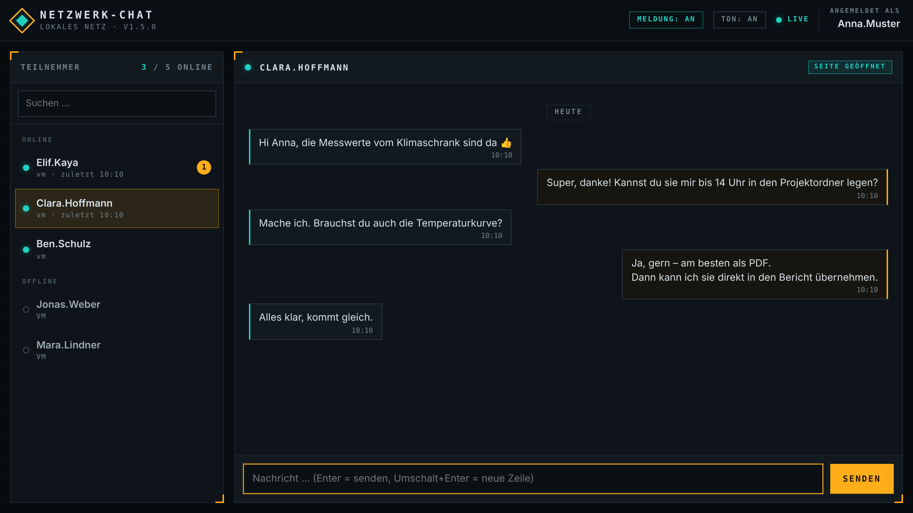
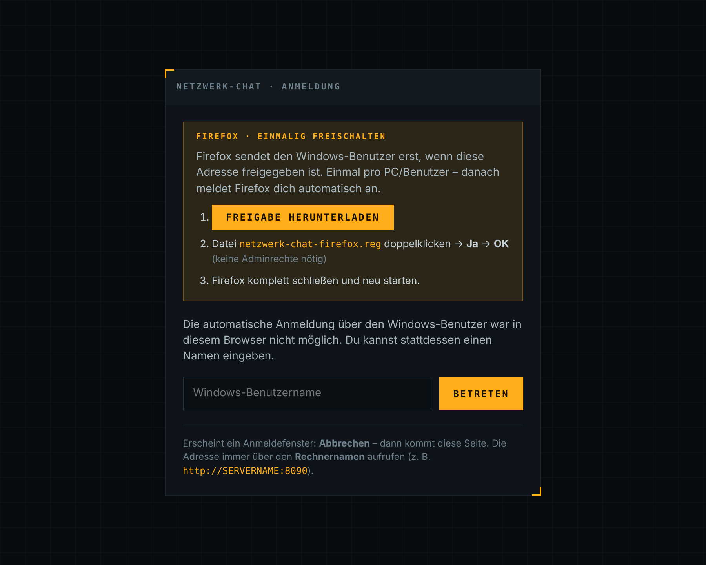
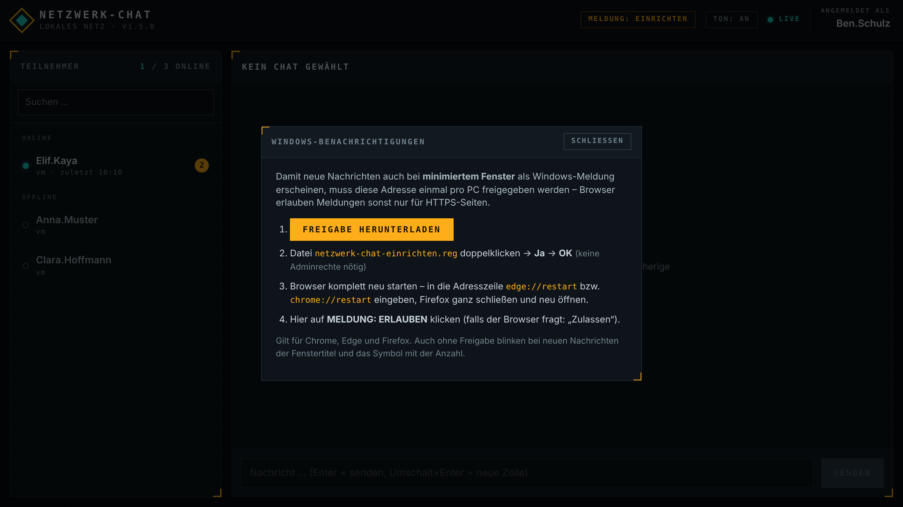

# Netzwerk-Chat v1.5.0

Lokaler Netzwerk-Chat als Website. Das Programm läuft auf **einem** Rechner im Netzwerk –
alle anderen öffnen nur die Seite im Browser. Keine Installation auf den Arbeitsplätzen.



## Funktionen
- **Automatische Anmeldung über den Windows-Benutzer** (integrierte Windows-Anmeldung / NTLM –
  derselbe Benutzername, den `whoami` anzeigt) – in Edge, Chrome **und Firefox**
- **Präsenz:** Alle Teilnehmer werden links angezeigt – Punkt grün = hat die Seite gerade geöffnet,
  Punkt leer = Seite geschlossen. Keine Aktivitätsanzeige.
- **Verschlüsselte Speicherung:** Chats werden in der Datenbank verschlüsselt abgelegt. Der Schlüssel
  existiert nur im Arbeitsspeicher und wird bei jedem Programmstart neu erzeugt.
- **Verlauf:** Jeder Chat mit einer Person wird beim erneuten Anklicken automatisch geladen –
  solange das Programm auf dem Server läuft. **Beim Neustart werden alle Chats verworfen.**
- **Hinweis auf neue Nachrichten auch bei minimiertem Fenster:** Windows-Benachrichtigung mit
  Absender und Text (nach einmaliger Freigabe), blinkender Fenstertitel, Symbol mit Zähler
- Ungelesen-Zähler, Hinweiston (abschaltbar)
- Nur Python-Standardbibliothek (Python ≥ 3.7) – als fertige Windows-exe oder auf einer
  **GL.iNet Brume 2** (Offline-Installationspaket)

## Start (auf dem Server-Rechner)
`NetzwerkChat.exe` aus dem GitHub-Release starten – oder mit Python:
```
python netzwerk_chat.py
```
(bzw. Doppelklick auf `start_netzwerk_chat.bat`).

Optionen:
| Option | Bedeutung |
|---|---|
| `--port 8090` | Port (Standard **8090**) |
| `--host 0.0.0.0` | Bind-Adresse |
| `--db pfad.db` | Speicherort der Datenbank (Standard: neben dem Programm / der exe) |
| `--no-manual-login` | Ersatzanmeldung per Namenseingabe abschalten |

Ist der Port belegt, meldet das Programm das und beendet sich – dann mit `--port` einen anderen wählen.

Beim ersten Start fragt die Windows-Firewall nach – Zugriff im **privaten Netzwerk** erlauben
(oder Port 8090 eingehend freigeben).

## Aufruf an den Arbeitsplätzen
```
http://SERVERNAME:8090
```
Wichtig: immer denselben **Rechnernamen ohne Punkt** verwenden, nicht die IP-Adresse.
- Nur dann behandeln Edge/Chrome die Seite als „Lokales Intranet“ und melden den Windows-Benutzer automatisch an.

Falls stattdessen ein Anmeldefenster erscheint:
- **Domänen-Netz:** Adresse per Gruppenrichtlinie in die Zone „Lokales Intranet“ aufnehmen
  (Site-to-Zone-Zuweisung, Wert `1`) – danach geht es überall ohne Rückfrage.
- **Einzelner PC:** `inetcpl.cpl` → Sicherheit → Lokales Intranet → Sites → Erweitert →
  `http://SERVERNAME` hinzufügen.
- Fenster abbrechen → es erscheint die Ersatzanmeldung per Namenseingabe (abschaltbar).

### Firefox
Firefox sendet den Windows-Benutzer nur an Adressen, die per Firefox-Richtlinie freigegeben sind.
Ohne Freigabe zeigt Firefox ein Anmeldefenster → **Abbrechen** → die Anmeldeseite bietet die Freigabe an:



1. **Freigabe herunterladen** – der Server erzeugt `netzwerk-chat-einrichten.reg` passend zu seiner Adresse
   (auch direkt abrufbar unter `http://SERVERNAME:8090/einrichten.reg`).
2. Datei doppelklicken → **Ja** → **OK**. Schreibt nur unter `HKEY_CURRENT_USER`, keine Adminrechte nötig.
3. Firefox komplett schließen und neu starten – ab jetzt automatische Anmeldung.

Die Datei setzt die Firefox-Richtlinie `Authentication` (`NTLM` = Servername, `AllowNonFQDN.NTLM` = an)
und schaltet gleichzeitig die Windows-Benachrichtigungen frei (siehe unten).
Firefox zeigt danach unter Einstellungen den Hinweis „Ihr Browser wird von Ihrer Organisation verwaltet“ –
das ist normal.

**Für viele PCs / Domäne:** dieselbe Richtlinie zentral verteilen – per Firefox-ADMX-Vorlage
(Authentifizierung → NTLM) oder mit `distribution/policies.json` im Firefox-Programmordner:
```json
{ "policies": { "Authentication": { "NTLM": ["SERVERNAME"], "AllowNonFQDN": { "NTLM": true } } } }
```

## Neue Nachrichten bei minimiertem Fenster
Ist das Chat-Fenster minimiert, verdeckt oder im Hintergrund, macht eine neue Nachricht sich bemerkbar durch:

| Hinweis | Voraussetzung |
|---|---|
| **Windows-Benachrichtigung** (Toast unten rechts) mit Absender und Text – Klick öffnet direkt den Chat | einmalige Freigabe pro PC (siehe unten) |
| **Blinkender Fenstertitel** „✉ Name schreibt …“ – sichtbar im Tab und in der Taskleiste (bei Taskleisten-Beschriftung bzw. beim Darüberfahren) | keine |
| **Symbol mit Zähler** (Tab-Symbol mit Anzahl ungelesener Nachrichten) | keine |
| Hinweiston | keine (Schalter **TON**) |

Das Blinken endet, sobald das Fenster wieder im Vordergrund ist.

### Windows-Benachrichtigungen einmalig freischalten
Browser erlauben Benachrichtigungen nur für HTTPS-Seiten. Damit sie auch für den Chat (`http://…`)
funktionieren, wird die Adresse einmal pro PC/Benutzer freigegeben:



1. Im Chat oben auf **MELDUNG: EINRICHTEN** klicken → **Freigabe herunterladen**.
2. `netzwerk-chat-einrichten.reg` doppelklicken → **Ja** → **OK** (nur `HKEY_CURRENT_USER`, keine Adminrechte).
3. Browser komplett neu starten: `edge://restart` bzw. `chrome://restart` in die Adresszeile,
   Firefox ganz schließen und neu öffnen.
4. Der Button zeigt jetzt **MELDUNG: ERLAUBEN** → anklicken → ggf. „Zulassen“. Danach **MELDUNG: AN**
   (per Klick ein-/ausschaltbar).

Die `.reg`-Datei setzt für die Server-Adresse(n):
- **Chrome / Edge:** `OverrideSecurityRestrictionsOnInsecureOrigin` und `NotificationsAllowedForUrls`
- **Firefox:** `Permissions → Notifications → Allow` und die Einstellung `dom.securecontext.allowlist`
  (plus die Windows-Anmeldung, siehe Abschnitt Firefox)
- **Windows:** Zuordnung zur Zone „Lokales Intranet“ – damit klappt die automatische Anmeldung in
  Edge/Chrome auch beim Aufruf über die IP-Adresse

Hinweise:
- Chrome/Edge zeigen danach „Von Ihrer Organisation verwaltet“ – das ist normal.
- In zentral verwalteten Umgebungen (Domäne mit Browser-Richtlinien) dieselben Richtlinien besser per
  Gruppenrichtlinie verteilen – die `.reg` kann vorhandene nummerierte Listeneinträge überschreiben.
- Erscheinen trotz **MELDUNG: AN** keine Meldungen: Windows-Einstellungen → System → Benachrichtigungen –
  für den Browser aktiviert? „Nicht stören“ / Fokus-Assistent aus?

## Verschlüsselung der gespeicherten Chats
- In `netzwerk_chat.db` stehen die Nachrichtentexte nur verschlüsselt (HMAC-SHA256-Schlüsselstrom +
  Prüfsumme, nur Python-Standardbibliothek). Wer die Datei kopiert oder öffnet, kann sie nicht lesen.
- Der Schlüssel wird beim Start zufällig erzeugt und nie auf die Platte geschrieben.
- Programm beenden/neu starten = Schlüssel weg = alle Chats werden beim nächsten Start gelöscht.
  Teilnehmerliste und Anmeldungen bleiben erhalten.
- Lesbar sind die Chats nur über das laufende Programm (Webseite) – also für die beiden Gesprächspartner.

## Hinweise
- Die Anmeldung liest nur den Windows-Benutzernamen aus, das Passwort wird **nicht** geprüft
  (es gibt keine Verbindung zum Domänencontroller). Für ein vertrauenswürdiges internes Netz gedacht,
  nicht für das Internet.
- Benutzer werden über den Namen ohne Domäne zugeordnet (Groß-/Kleinschreibung egal).
- Die Datenbank `netzwerk_chat.db` liegt neben dem Programm bzw. der exe.
- Anmeldung bleibt 30 Tage per Cookie gespeichert.

## GitHub Actions: exe, Brume-2-Paket und Release
Der Workflow `.github/workflows/build-release.yml` läuft bei **jedem Push** auf `main`/`master`
(und manuell über **Actions → „Build und Release“ → Run workflow**):

1. baut die Windows-exe (`NetzwerkChat-v<Version>-windows.exe` + ZIP),
2. baut das Offline-Paket für die Brume 2 (`NetzwerkChat-v<Version>-brume2-offline.tar.gz`,
   inkl. Python-Paketen),
3. legt **automatisch ein Release** `v<Version>` an, wenn es zur `VERSION` in `netzwerk_chat.py`
   noch keins gibt. Neue Version veröffentlichen = `VERSION` erhöhen und pushen.

Bei Pushes ohne neue Version wird nur gebaut – die Dateien hängen dann am Workflow-Lauf unter *Artifacts*.

**Wenn unter „Actions“ nichts erscheint:**
- Der Ordner **`.github`** fehlt im Repo. Er ist versteckt (Punkt am Anfang) und wird beim Hochladen
  per Drag & Drop oder im Mac-Finder leicht übersehen. Im Finder versteckte Dateien mit
  **⌘ + ⇧ + .** einblenden; unter Windows im Explorer *Ansicht → Ausgeblendete Elemente*.
  Im Repo muss die Datei unter `.github/workflows/build-release.yml` liegen.
  Notfalls auf GitHub **Add file → Create new file**, als Namen `.github/workflows/build-release.yml`
  eingeben und den Inhalt einfügen.
- *Settings → Actions → General*: „Allow all actions and reusable workflows“ muss aktiv sein.
- Kein Release trotz grünem Lauf: *Settings → Actions → General → Workflow permissions* auf
  **„Read and write permissions“** stellen.

## GL.iNet Brume 2
Netzwerk-Chat läuft auch auf einer **GL.iNet Brume 2** – dann ist kein Windows-Server-PC nötig.
Das Offline-Paket enthält Python 3, auf der Brume 2 ist **kein Internet** nötig:

```
scp -O NetzwerkChat-v1.5.0-brume2-offline.tar.gz root@<IP-der-Brume>:/tmp/
ssh root@<IP-der-Brume>
cd /tmp && tar -xzf NetzwerkChat-v1.5.0-brume2-offline.tar.gz
sh NetzwerkChat-brume2/install.sh
```
Installiert nach `/root/Netzwerk-Chat`, richtet den Autostart ein und gibt den Port in der Firewall frei.
Das Paket kommt fertig aus dem GitHub-Release oder wird im Ordner `brume2` selbst erstellt –
per `pakete_herunterladen_mac.sh` (Mac) oder `pakete_herunterladen_windows.bat` (Windows).
Details: `brume2/ANLEITUNG_BRUME2.md`.

## EXE offline bauen (ohne GitHub)
Im Ordner `offline_build_kit` liegt ein Offline-Build-Kit: Ein Rechner mit Internet lädt PyInstaller
als Windows-Pakete herunter – per `1_mac_pakete_herunterladen.sh` (Mac) **oder**
`1_windows_pakete_herunterladen.bat` (Windows). Ein Windows-10-PC mit Python 3.11 installiert sie
ohne Internet und baut `NetzwerkChat-v<Version>-windows.exe`. Ablauf siehe `offline_build_kit/ANLEITUNG.md`.
